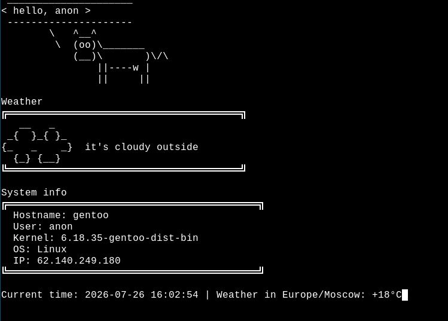

<div align="center">

# sysweather

**Weather and system information in your terminal.**
```
_____________________
 hello, anon
---------------------
        \   ^__^
         \  (oo)\_______
            (__)\       )\/\
                ||----w |
                ||     ||

weather
╔══════════════════════════════════════════╗
   __   _
 _{  }_{ }_
{_   _    _}  it's cloudy outside
  {_} {__}
╚══════════════════════════════════════════╝
system info
╔══════════════════════════════════════════╗
  hostname: gentoolinux
  user: anon
  kernel: 6.18.57-gentoo-dist-bin
  os: 'Gentoo Linux'
╚══════════════════════════════════════════╝
```
[](LICENSE)
[](https://en.cppreference.com/w/cpp/17)



</div>

## Install on Linux

Requires `g++` and an internet connection.

```sh
git clone https://github.com/Efesint/sysweather
cd sysweather

g++ -O2 -std=c++17 src/sysweather.cpp -o sysweather -pthread
sudo install -m 755 sysweather /usr/local/bin/sysweather

mkdir -p ~/sysweather
```

Then run:

```sh
sysweather
```

> On first launch, enter your city in [wttr.in](https://wttr.in) format, for example `Europe/Berlin`. It is saved to `~/sysweather/config.txt`.

## Uninstall

```sh
sudo rm /usr/local/bin/sysweather
rm -rf ~/sysweather
```

## Third-party

- [cpp-httplib](https://github.com/yhirose/cpp-httplib) — MIT License, Copyright (c) 2017 yhirose

## License

GNU General Public License v3.0
